# Data lineage – dwh_gold

Genereret 2026-10-29 20:00 af pbip-catalog. Farver: sort = datakilde, grå = Power Query, mørk = tabel, hvid = kolonne, turkis = measure, rosa = dashboard.

## Overblik (tabelniveau)

Datakilder → delte Power Query-queries → tabeller → rapportsider.

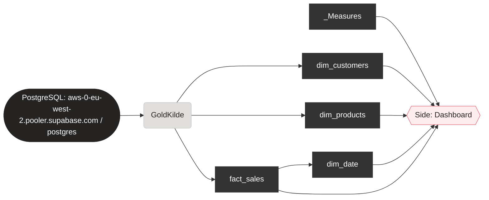

## Dashboard-pladser

Én graf pr. plads på dashboard-siden fra pbip-layout: measure → afhængige measures → kolonner → oprindelse i kilden.

### KPI 1

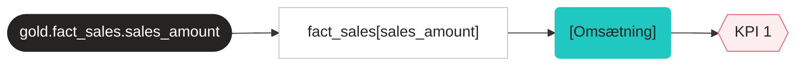

| Kolonne | Oprindelse | Power Query-trin |
|---|---|---|
| `fact_sales[sales_amount]` | gold.fact_sales.sales_amount | fact_sales: Navigation (gold.fact_sales) |

### KPI 2

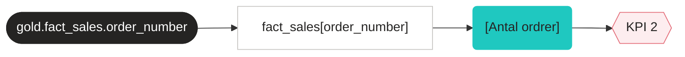

| Kolonne | Oprindelse | Power Query-trin |
|---|---|---|
| `fact_sales[order_number]` | gold.fact_sales.order_number | fact_sales: Navigation (gold.fact_sales) |

### KPI 3

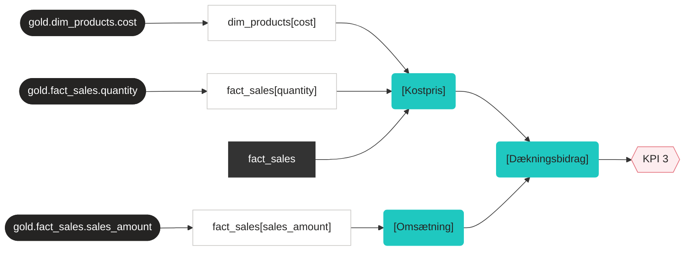

| Kolonne | Oprindelse | Power Query-trin |
|---|---|---|
| `dim_products[cost]` | gold.dim_products.cost | dim_products: Navigation (gold.dim_products) |
| `fact_sales[quantity]` | gold.fact_sales.quantity | fact_sales: Navigation (gold.fact_sales) |
| `fact_sales[sales_amount]` | gold.fact_sales.sales_amount | fact_sales: Navigation (gold.fact_sales) |

### KPI 4

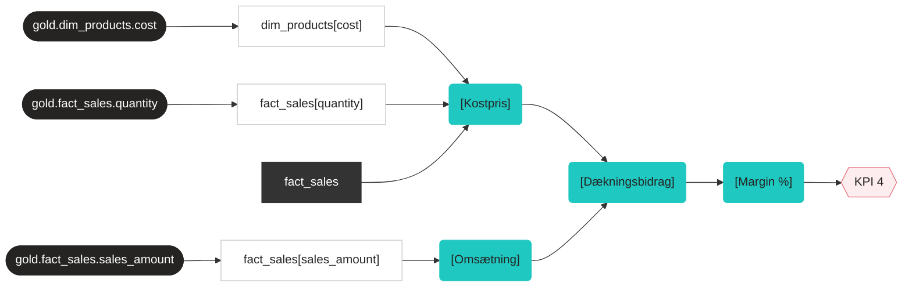

| Kolonne | Oprindelse | Power Query-trin |
|---|---|---|
| `dim_products[cost]` | gold.dim_products.cost | dim_products: Navigation (gold.dim_products) |
| `fact_sales[quantity]` | gold.fact_sales.quantity | fact_sales: Navigation (gold.fact_sales) |
| `fact_sales[sales_amount]` | gold.fact_sales.sales_amount | fact_sales: Navigation (gold.fact_sales) |

### Trend

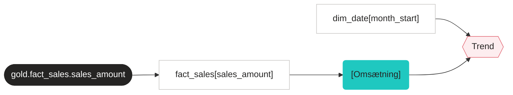

| Kolonne | Oprindelse | Power Query-trin |
|---|---|---|
| `dim_date[month_start]` | Beregnet i dim_date (trin Maanedstart) | dim_date: Beregnet (each Date.StartOfMonth([date_key])) |
| `fact_sales[sales_amount]` | gold.fact_sales.sales_amount | fact_sales: Navigation (gold.fact_sales) |

### Månedskort 1

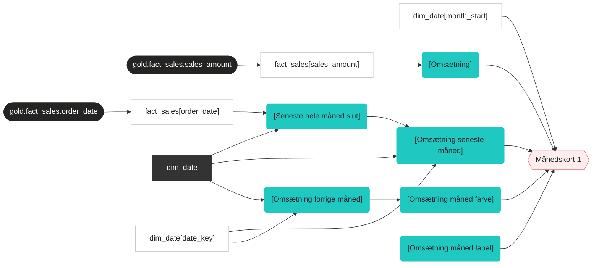

| Kolonne | Oprindelse | Power Query-trin |
|---|---|---|
| `dim_date[date_key]` | Beregnet i dim_date (trin Start) | – |
| `dim_date[month_start]` | Beregnet i dim_date (trin Maanedstart) | dim_date: Beregnet (each Date.StartOfMonth([date_key])) |
| `fact_sales[order_date]` | gold.fact_sales.order_date | fact_sales: Navigation (gold.fact_sales) |
| `fact_sales[sales_amount]` | gold.fact_sales.sales_amount | fact_sales: Navigation (gold.fact_sales) |

### Månedskort 2

| Kolonne | Oprindelse | Power Query-trin |
|---|---|---|
| `dim_date[date_key]` | Beregnet i dim_date (trin Start) | – |
| `dim_date[month_start]` | Beregnet i dim_date (trin Maanedstart) | dim_date: Beregnet (each Date.StartOfMonth([date_key])) |
| `fact_sales[order_date]` | gold.fact_sales.order_date | fact_sales: Navigation (gold.fact_sales) |
| `fact_sales[order_number]` | gold.fact_sales.order_number | fact_sales: Navigation (gold.fact_sales) |

### Månedskort 3

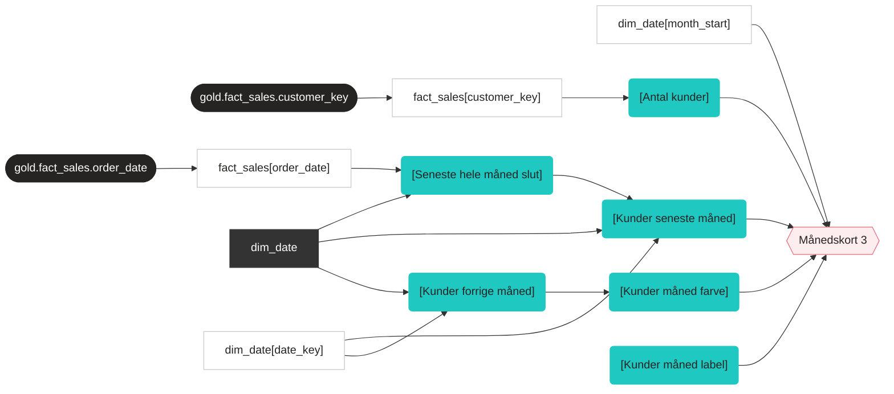

| Kolonne | Oprindelse | Power Query-trin |
|---|---|---|
| `dim_date[date_key]` | Beregnet i dim_date (trin Start) | – |
| `dim_date[month_start]` | Beregnet i dim_date (trin Maanedstart) | dim_date: Beregnet (each Date.StartOfMonth([date_key])) |
| `fact_sales[customer_key]` | gold.fact_sales.customer_key | fact_sales: Navigation (gold.fact_sales) |
| `fact_sales[order_date]` | gold.fact_sales.order_date | fact_sales: Navigation (gold.fact_sales) |

### Søjler pr. kategori

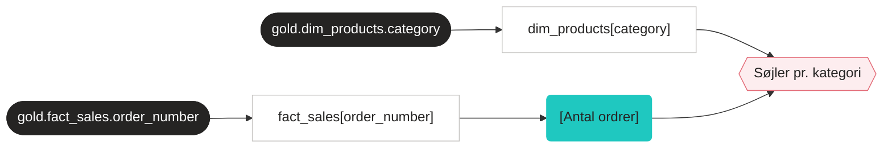

| Kolonne | Oprindelse | Power Query-trin |
|---|---|---|
| `dim_products[category]` | gold.dim_products.category | dim_products: Navigation (gold.dim_products) |
| `fact_sales[order_number]` | gold.fact_sales.order_number | fact_sales: Navigation (gold.fact_sales) |

### Top 10-tabel

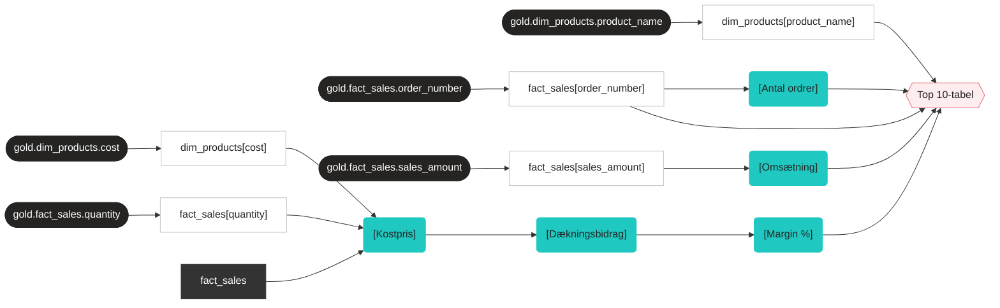

| Kolonne | Oprindelse | Power Query-trin |
|---|---|---|
| `dim_products[cost]` | gold.dim_products.cost | dim_products: Navigation (gold.dim_products) |
| `dim_products[product_name]` | gold.dim_products.product_name | dim_products: Navigation (gold.dim_products) |
| `fact_sales[order_number]` | gold.fact_sales.order_number | fact_sales: Navigation (gold.fact_sales) |
| `fact_sales[quantity]` | gold.fact_sales.quantity | fact_sales: Navigation (gold.fact_sales) |
| `fact_sales[sales_amount]` | gold.fact_sales.sales_amount | fact_sales: Navigation (gold.fact_sales) |

### Fremhævning 1

| Kolonne | Oprindelse | Power Query-trin |
|---|---|---|
| `dim_products[subcategory]` | gold.dim_products.subcategory | dim_products: Navigation (gold.dim_products) |
| `fact_sales[order_number]` | gold.fact_sales.order_number | fact_sales: Navigation (gold.fact_sales) |

### Fremhævning 2

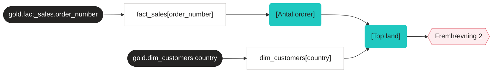

| Kolonne | Oprindelse | Power Query-trin |
|---|---|---|
| `dim_customers[country]` | gold.dim_customers.country | dim_customers: Navigation (gold.dim_customers) |
| `fact_sales[order_number]` | gold.fact_sales.order_number | fact_sales: Navigation (gold.fact_sales) |

## Kolonne-lineage pr. tabel

<b>dim_customers</b> (10 kolonner)

| Kolonne | Oprindelse | Power Query-trin / DAX |
|---|---|---|
| `customer_key` | gold.dim_customers.customer_key | dim_customers: Navigation (gold.dim_customers) |
| `customer_id` | gold.dim_customers.customer_id | dim_customers: Navigation (gold.dim_customers) |
| `customer_number` | gold.dim_customers.customer_number | dim_customers: Navigation (gold.dim_customers) |
| `first_name` | gold.dim_customers.first_name | dim_customers: Navigation (gold.dim_customers) |
| `last_name` | gold.dim_customers.last_name | dim_customers: Navigation (gold.dim_customers) |
| `country` | gold.dim_customers.country | dim_customers: Navigation (gold.dim_customers) |
| `marital_status` | gold.dim_customers.marital_status | dim_customers: Navigation (gold.dim_customers) |
| `gender` | gold.dim_customers.gender | dim_customers: Navigation (gold.dim_customers) |
| `birthdate` | gold.dim_customers.birthdate | dim_customers: Navigation (gold.dim_customers) |
| `create_date` | gold.dim_customers.create_date | dim_customers: Navigation (gold.dim_customers) |

<b>dim_date</b> (10 kolonner)

| Kolonne | Oprindelse | Power Query-trin / DAX |
|---|---|---|
| `date_key` | Beregnet i dim_date (trin Start) | – |
| `year` | Beregnet i dim_date (trin Aar) | dim_date: Beregnet (each Date.Year([date_key])) |
| `quarter` | Beregnet i dim_date (trin Kvartal) | dim_date: Beregnet (each "K" & Text.From(Date.QuarterOfYear([date_key]))) |
| `month_no` | Beregnet i dim_date (trin MaanedNr) | dim_date: Beregnet (each Date.Month([date_key])) |
| `month_name` | Beregnet i dim_date (trin Maaned) | dim_date: Beregnet (each Date.ToText([date_key], [Format = "MMM", Culture = "da…) |
| `year_month` | Beregnet i dim_date (trin AarMaaned) | dim_date: Beregnet (each Date.ToText([date_key], [Format = "yyyy-MM"])) |
| `month_start` | Beregnet i dim_date (trin Maanedstart) | dim_date: Beregnet (each Date.StartOfMonth([date_key])) |
| `week_no` | Beregnet i dim_date (trin Uge) | dim_date: Beregnet (each Date.WeekOfYear([date_key], Day.Monday)) |
| `day_of_week_no` | Beregnet i dim_date (trin UgedagNr) | dim_date: Beregnet (each Date.DayOfWeek([date_key], Day.Monday) + 1) |
| `day_name` | Beregnet i dim_date (trin Ugedag) | dim_date: Beregnet (each Date.ToText([date_key], [Format = "ddd", Culture = "da…) |

<b>dim_products</b> (11 kolonner)

| Kolonne | Oprindelse | Power Query-trin / DAX |
|---|---|---|
| `product_key` | gold.dim_products.product_key | dim_products: Navigation (gold.dim_products) |
| `product_id` | gold.dim_products.product_id | dim_products: Navigation (gold.dim_products) |
| `product_number` | gold.dim_products.product_number | dim_products: Navigation (gold.dim_products) |
| `product_name` | gold.dim_products.product_name | dim_products: Navigation (gold.dim_products) |
| `category_id` | gold.dim_products.category_id | dim_products: Navigation (gold.dim_products) |
| `category` | gold.dim_products.category | dim_products: Navigation (gold.dim_products) |
| `subcategory` | gold.dim_products.subcategory | dim_products: Navigation (gold.dim_products) |
| `maintenance` | gold.dim_products.maintenance | dim_products: Navigation (gold.dim_products) |
| `cost` | gold.dim_products.cost | dim_products: Navigation (gold.dim_products) |
| `product_line` | gold.dim_products.product_line | dim_products: Navigation (gold.dim_products) |
| `start_date` | gold.dim_products.start_date | dim_products: Navigation (gold.dim_products) |

<b>fact_sales</b> (9 kolonner)

| Kolonne | Oprindelse | Power Query-trin / DAX |
|---|---|---|
| `order_number` | gold.fact_sales.order_number | fact_sales: Navigation (gold.fact_sales) |
| `product_key` | gold.fact_sales.product_key | fact_sales: Navigation (gold.fact_sales) |
| `customer_key` | gold.fact_sales.customer_key | fact_sales: Navigation (gold.fact_sales) |
| `order_date` | gold.fact_sales.order_date | fact_sales: Navigation (gold.fact_sales) |
| `shipping_date` | gold.fact_sales.shipping_date | fact_sales: Navigation (gold.fact_sales) |
| `due_date` | gold.fact_sales.due_date | fact_sales: Navigation (gold.fact_sales) |
| `sales_amount` | gold.fact_sales.sales_amount | fact_sales: Navigation (gold.fact_sales) |
| `quantity` | gold.fact_sales.quantity | fact_sales: Navigation (gold.fact_sales) |
| `price` | gold.fact_sales.price | fact_sales: Navigation (gold.fact_sales) |

